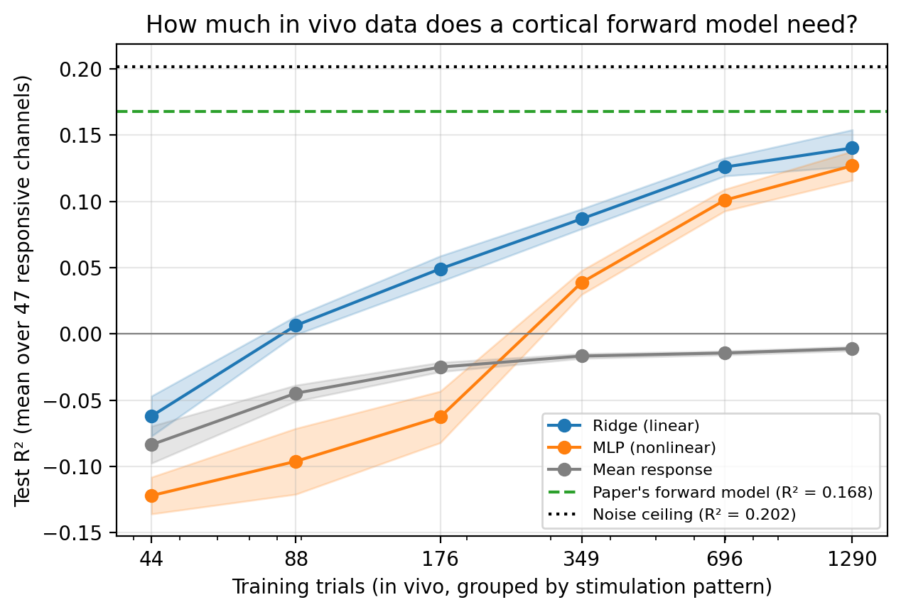

# How Much In Vivo Data Does a Cortical Forward Model Need?
### Learning curves on the public dataset from Moure et al. (2026)

Moure et al. (2026) trained a deep forward model on months of recordings from a 96-channel
Utah array in the visual cortex of a blind participant, and used it to design stimulation
that shapes evoked activity. Personalizing such models requires substantial data from each
user. Using the authors' public in vivo dataset, this mini-analysis asks: **how many trials
does a simple forward model (stimulation → evoked response) need, and how does it compare
with the paper's model and with the noise ceiling set by trial-to-trial variability?**

## Data
- Public data from Moure et al. (2026) (`df_results.pkl`): 1,645 in vivo trials from the
  final two experimental days, with the delivered stimulation (96 electrodes), the evoked
  response (ΔMUAe), and the paper's forward-model prediction for each trial.
- 370 unique stimulation patterns, almost all repeated 4–5 times. The 40 zero-stimulation
  trials were excluded from the learning curves.
- R² is computed per channel and averaged over the 47 channels with response variance > 0.2.
- The full training dataset used in the paper is not public, so all models here are trained
  only on these in vivo trials.

## Methods
- **Splits:** 20% of stimulation patterns held out for testing (5 random splits). All repeats
  of a pattern stay on the same side of every split, so test stimuli are never seen in training.
- **Training sizes:** 10 to ~300 patterns (~44 to ~1,290 trials), 3 random draws per size.
- **Models:** mean-response baseline; ridge regression (regularization chosen by
  cross-validation grouped by pattern); a two-layer MLP (128 units per layer, fixed settings).
- **Inputs:** stimulation only. Per-trial pre-stimulus activity was not used, because ΔMUAe
  is computed by subtracting it, which would let a model "predict" the response without
  learning anything about stimulation. (The paper used each day's average pre-stimulus
  activity instead; day labels are not included in the public data.)
- **References:** the paper's forward-model predictions on the same test trials, and a
  repeat-based noise ceiling (each trial predicted by the mean of the other repeats of the
  same pattern).

## Results
**1. Trial-to-trial noise limits any forward model.** The repeat-based noise ceiling was
R² = 0.202 on the test sets (0.250 on all trials). The paper's forward model reached
R² = 0.168, about 83% of the explainable variance, even though it was trained on a
different distribution of stimuli (random and structured patterns).

**2. A linear model learns quickly.** Ridge regression beat the mean-response baseline from
about 90 training trials and reached R² = 0.140 with about 1,290 trials, roughly 83% of the
paper's model.

**3. With this little data, the linear model outperformed the neural network.** The MLP
became positive only around 350 trials and trailed ridge at every size (0.127 vs. 0.140 at
the largest). Its curve was steeper at larger sizes, which may mean it would overtake ridge
with more data, consistent with the paper's finding that responses are nonlinear.

## Limitations
- Only the final two days of in vivo data are public, and those stimuli were optimized rather
  than random, so the learning curves describe this distribution only.
- Models are trained and tested on the same type of stimuli, which favors them relative to
  the paper's model.
- The MLP used fixed hyperparameters while ridge was tuned; a tuned MLP might do better. MLP
  early stopping used an ungrouped validation split.
- The noise ceiling averages only 3–4 repeats, so it is a conservative (low) estimate.
- Responsive channels were selected by variance only; the paper also required spiking
  activity (54 channels), so absolute values differ from the paper's figures.
- Single participant.

## Reproducing
Open `cortical_learning_curve.ipynb` in Google Colab. The notebook clones the authors'
repository (https://github.com/jgranley/deep_neural_shaping) to load the data; no data is
redistributed here.

## Reference
Moure, P., Granley, J., Grani, F., Soo, L., Lozano, A., López-Peco, R., Villamarín-Ortiz, A.,
Soto-Sánchez, C., Liu, S.-C., Beyeler, M., & Fernández, E. (2026). Deep learning-based
control of electrically evoked activity in human visual cortex. *Neuron*, 114, 1–15.
https://doi.org/10.1016/j.neuron.2026.07.006
